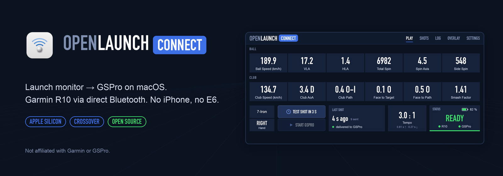
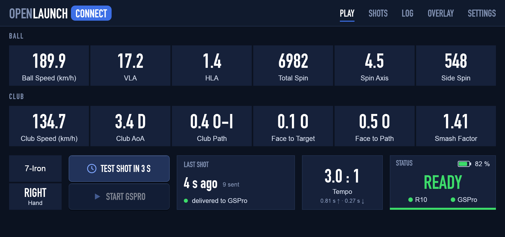
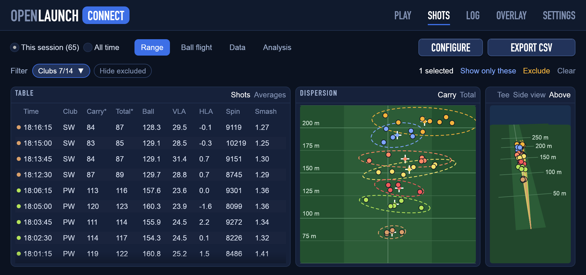
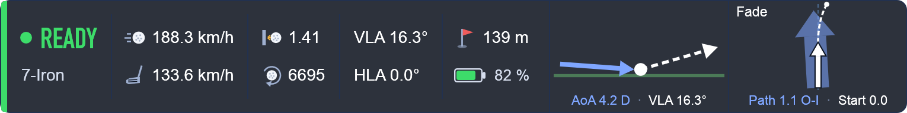
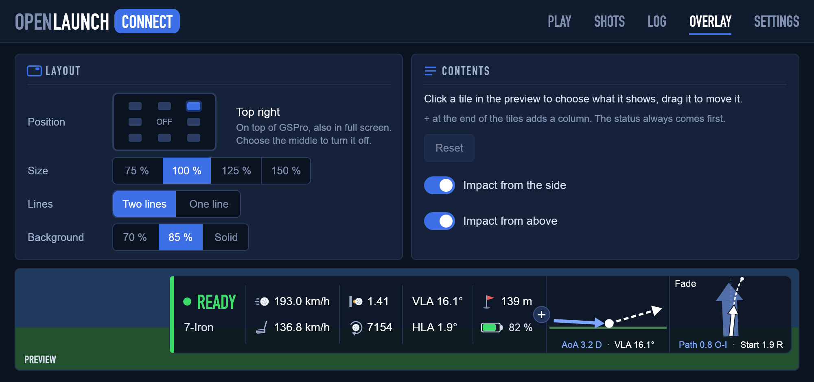
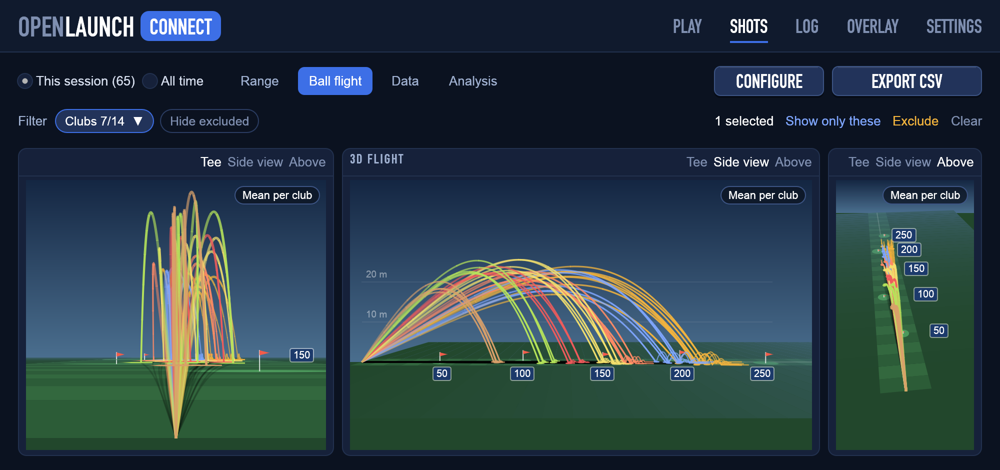
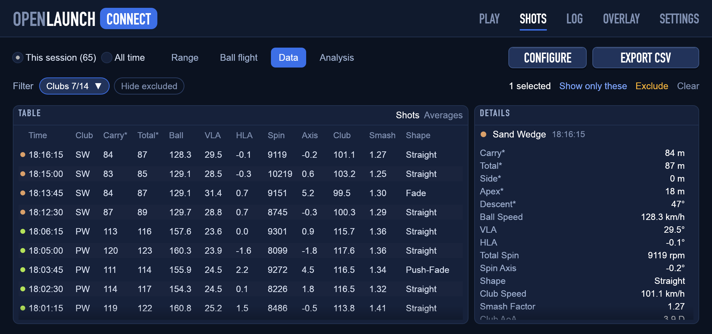
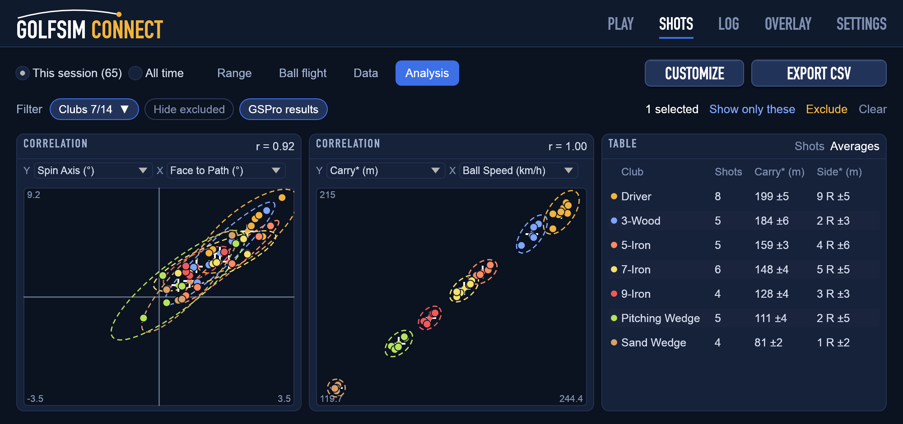
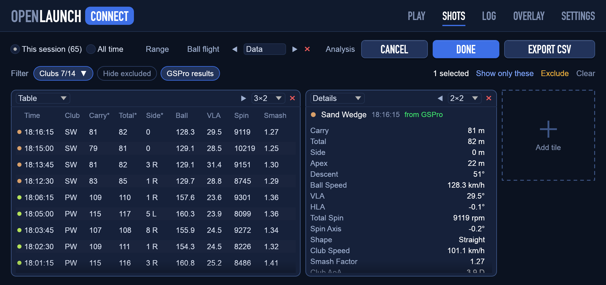
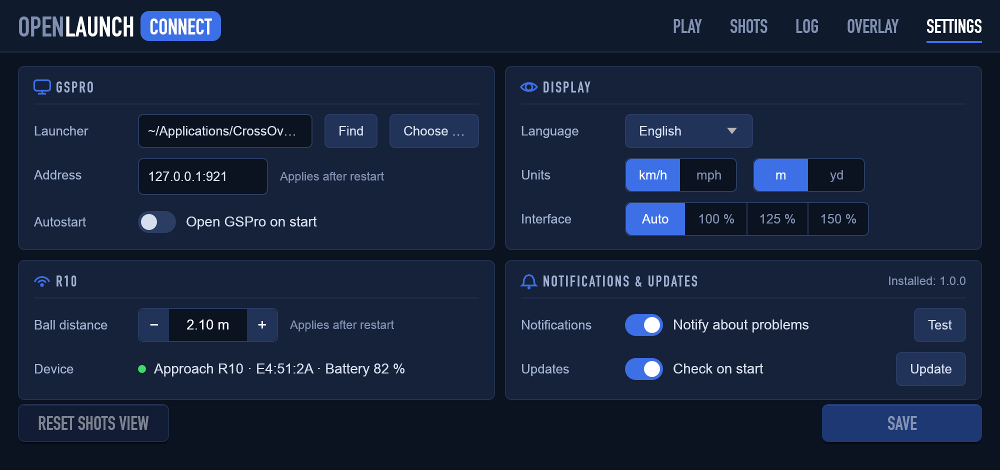

<p align="center">
  
</p>

<p align="center">
  <a href="https://github.com/chgl42/openlaunch-connect/releases/latest"></a>
  <a href="https://github.com/chgl42/openlaunch-connect/actions/workflows/build.yml"></a>
  
  
  <a href="https://buymeacoffee.com/chgl42"></a>
</p>

**OpenLaunch Connect** (formerly *OpenR10 Connect*) is a small, native macOS app that connects a **Garmin Approach R10** launch monitor
directly via Bluetooth and forwards every shot to **GSPro** through its OpenConnect API – including GSPro
running under **CrossOver** on an Apple Silicon Mac.

> Not affiliated with, endorsed by, or sponsored by Garmin or GSPro.

The Garmin Approach R10 is the first supported launch monitor; the app is built so that more can follow.

## Why this exists

GSPro is Windows-only. On a Mac it runs well under CrossOver – but the Garmin R10 talks Bluetooth LE,
and CrossOver/Wine does not pass Bluetooth through to Windows programs. The Windows connectors that talk
to the R10 directly therefore can't reach it.

The usual workaround is a chain of devices and apps:

```
R10 ──BLE──> iPhone (Garmin Golf app) ──Wi-Fi──> "E6 Connect" emulation (gspro-r10) ──> GSPro
```

It works, but it is fiddly and fragile: the phone has to stay awake and in the foreground, the Garmin app
has to be put into E6 mode every session, and any of the three hops can drop.

**OpenLaunch Connect removes the detour.** It does the Bluetooth part natively on macOS, where it works, and
hands the shots to GSPro over a local TCP connection, which CrossOver handles perfectly:

```
R10 ──BLE──> OpenLaunch Connect (macOS) ──TCP 127.0.0.1:921──> GSPro (CrossOver)
```

One app, a stable connection, no phone in the loop.

## Features

- **Direct Bluetooth connection** to the R10 – no iPhone, no Garmin app, no E6
- **Automatic reconnects** on both sides (R10 and GSPro); start them in any order
- **All shot data the R10 measures**: ball speed, launch angle (VLA), launch direction (HLA), total spin,
  spin axis, back/side spin, club speed, angle of attack, club path, face to target, face to path
- **Club and handedness from GSPro** shown live, plus **smash factor**
- **Shot explorer:** pages of tiles you arrange yourself – shots table, averages per club, details of a shot,
  dispersion of the landing points, correlation of any two values, 3D flights – with a filter by club and a
  selection shared by all tiles; **estimated carry, total, apex and side** and the **shot shape** for every shot
- **CSV export** in three layouts: OpenLaunch, **Garmin Golf** app or **Awesome Golf** (same columns and units row as theirs)
- **In-game overlay** on top of GSPro – also in full screen – with status, club, battery and the last shot;
  place it in any corner or at the middle of any edge, choose its size, one or two lines and which values it shows;
  **impact graphics** for angle of attack / launch angle and club path / start direction with the shot shape
- **Swing tempo** (backswing : downswing, e.g. 3.0 : 1) per shot, per club and in the overlay
- **R10 battery level** and device warnings (tilted, overheating, radar saturation)
- **macOS notifications** while GSPro is in front: low battery, R10 errors, lost connections, shots not delivered
- **Test shot** button to check the GSPro side without hitting a ball
- **Start GSPro** from the app (finds the CrossOver launcher), optionally automatically
- **English and German** interface (follows the macOS language, or choose in Settings)
- Metric or imperial display, built-in log, settings persisted per user
- Interface styled after GSPro's own in-game look

<p align="center">
  
</p>

<p align="center">
  
</p>

<p align="center">
  
</p>

## Requirements

- Mac with **Apple Silicon** (macOS 12 or newer)
- **Garmin Approach R10**
- **GSPro** with a license for the R10 (e.g. running in CrossOver)

## Installation

### Option A – install script (recommended)

```bash
curl -fsSL https://raw.githubusercontent.com/chgl42/openlaunch-connect/main/install.sh | bash
```

Downloads the latest release, installs it to `/Applications` and removes the download quarantine.

### Option B – manual download

1. Download `OpenLaunch-Connect-macos-arm64.zip` from the [latest release](https://github.com/chgl42/openlaunch-connect/releases/latest).
2. Unzip and move **OpenLaunch Connect.app** to `/Applications`.
3. The app is ad-hoc signed but not notarized, so Gatekeeper blocks it on first launch. Run once:
   ```bash
   xattr -dr com.apple.quarantine "/Applications/OpenLaunch Connect.app"
   ```

On first start macOS asks **"OpenLaunch Connect would like to use Bluetooth"** → *Allow*.

### Option C – build from source

Requires [Rust](https://rustup.rs) 1.94 or newer.

```bash
git clone https://github.com/chgl42/openlaunch-connect.git
cd openlaunch-connect
./make-app.sh --install
```

## Usage

1. **Turn off Bluetooth on your iPhone** (or quit the Garmin Golf app) – otherwise the phone grabs the R10.
2. Switch on the R10. The very first time, hold the button until the LED is **solid blue** (pairing mode).
3. Start **OpenLaunch Connect**. If macOS shows a pairing request, confirm it.
4. Start GSPro (button **START GSPRO** or automatically, see settings) and click *Play* in the launcher.
5. When the status panel shows a green **READY**, hit away.

| Status | Meaning |
|---|---|
| **READY** (green) | R10 armed and GSPro connected |
| **NO GSPRO** / **NOT READY** (amber) | one side is connected, the other isn't ready yet |
| **NO R10** (red) | searching for the R10 – also shown a few seconds after the R10 is switched off; the app reconnects on its own |

Hover over the status panel for details; the **LOG** page shows everything that happens. **COPY LOG** copies
the log with the app's version, ready to paste into an issue; your home folder shows as `~` and email addresses as
`<email>`. The **HELP** page lists the common fixes (see *Troubleshooting*) and how to ask for help.

**Swing tempo:** next to the buttons the play page shows the tempo of the last swing (backswing : downswing,
e.g. *3.0 : 1*, with both times). It needs a real swing – test shots have none.

**Overlay:** while GSPro runs in full screen, a small panel on top of it shows the status, club, battery,
tempo and the last shot – or what's wrong. It ignores the mouse, so it never gets in the way. On the *Overlay*
page you choose its position (or turn it off), size (75–150 %), one or two lines, how opaque its background is
and which values it shows; a preview shows the result, and changes apply at once. The **impact graphics** next to
the values show the club head arriving at the angle of attack and the ball leaving at the launch angle (side view),
and the club path (broad arrow) with the start direction and the curving flight of the ball (top view) – angles drawn
three times larger, the shot shape's name on top.

<p align="center">
  
</p>

**Updates:** on start the app asks GitHub for the latest release (nothing else is sent) and shows *Update x.y.z*
in the top bar when there is a newer one – click it to open the release page. You can turn the check off in the settings.

**Notifications:** when GSPro is in front, macOS notifications report a low R10 battery, R10 errors (e.g. tilted),
a lost R10 or GSPro connection and shots that didn't reach GSPro – each at most once a minute.

**Test shot:** click **TEST SHOT IN 3 S** and switch to the GSPro window – a slightly randomised 7-iron
is sent after three seconds. GSPro only processes shots while its window is active and a ball is teed up
(range or course, not a menu).

### Shots page – the shot explorer

Every shot of the session (or *all time*) on **pages of tiles**. The app comes with three pages – *Range*, *Ball
flight* and *Data* – and you can add your own. The tiles:

| Tile | Shows |
|---|---|
| **Table** | the shots, latest first, with as many columns as fit (carry\*, total\*, ball and club speed, VLA, HLA, spin, axis, smash, face to path, tempo, shot shape) – or, switched to *Averages*, mean ± spread per club |
| **Details** | every value of the shot clicked last (or the latest): the R10's data plus estimated carry, total, side, apex, landing angle and the shot shape |
| **Dispersion** | where the balls landed (*Carry*) or stopped (*Total*), seen from above on a range, with each club's mean and an ellipse around its shots |
| **Correlation** | any two of 16 values against each other (e.g. face to path against spin axis) with the correlation coefficient *r*; values with a sign are centred on 0, so the quadrants are easy to read |
| **3D flight** | the estimated flights with the roll-out, from the tee, from the side or from above |

Values marked with \* are estimated from the launch data (no wind, sea level) – GSPro doesn't send its own numbers back.
The **shot shape** (straight, draw, fade, hook, slice, push, pull, push-draw …) comes from the start direction and
the spin axis, named for right-handers.

<p align="center">
  
</p>

<p align="center">
  
</p>

<p align="center">
  
</p>

**Filter and selection:** the club filter (a menu when there are many clubs) and *Hide excluded* apply to every tile.
Click a shot in a table or a dot in a chart to select it everywhere; then show only the selected shots, or
*Exclude* misreads from the stats and exports (*Count* takes them back).

**Your own pages:** *CUSTOMIZE* shows an empty tile with **+** to add tiles, a menu on each tile for what it shows
and its size (1×1 up to the whole page), and lets you drag tiles into place or remove them (×). The page shown can be
renamed, moved and removed right in its tab; **+** next to the tabs adds a page. *DONE* keeps the changes, *CANCEL*
undoes them. The layout is saved; *Reset shots view* in the settings brings back the default pages.

<p align="center">
  
</p>

*EXPORT CSV* writes the shots shown and asks for the layout: OpenLaunch, Garmin Golf or Awesome Golf.

## Settings

<p align="center">
  
</p>

| Group | Setting | Description |
|---|---|---|
| GSPro | **Launcher** | CrossOver launcher of GSPro. *Find* searches `~/Applications/CrossOver/…`; *Choose …* picks it manually. |
| | **Open GSPro automatically on start** | Starts GSPro together with the app (never twice). |
| | **Address** | OpenConnect address (default `127.0.0.1:921`). Applies after restart. |
| R10 | **Distance to ball** | Sent to the R10 (default 2.10 m). Applies after restart. |
| Display | **Language** | System (follows macOS), English or Deutsch. |
| | **Units** | Metric (km/h) or imperial (mph) – display only; GSPro always gets mph. |
| Notifications & updates | **Notifications** | On/off. *Test* sends one right away – if none appears, allow notifications for OpenLaunch Connect in *System Settings → Notifications*. |
| | **Updates** | Check GitHub for a newer release on start. |

*Log GSPro messages* (every message exchanged with GSPro) is switched on the log page, the overlay on its own
*Overlay* page.

Changes apply with **SAVE**; the notification and debug-log switches take effect immediately.

Settings are stored in `~/Library/Application Support/OpenLaunch Connect/settings.json`, the shot history
in `shots.jsonl` in the same folder (one JSON object per shot; test shots are not recorded).

## Troubleshooting

The app's **HELP** page has the common fixes in short. Still stuck? Press **COPY LOG** on the Log page and
[open an issue](https://github.com/chgl42/openlaunch-connect/issues) with the log pasted in.

- **NO R10 stays red** – Is the R10 on? Is iPhone Bluetooth off? Check *System Settings → Privacy & Security → Bluetooth* and allow OpenLaunch Connect.
- **R10 shows "Device error"** – usually the R10 is not level. Put it on a flat surface.
- **"No handshake"** – a macOS pairing dialog may be hidden; otherwise switch the R10 off and on.
- **No notifications** – click *Test* in the settings; if nothing appears, allow notifications for OpenLaunch Connect in *System Settings → Notifications* (macOS shows them only while the app is in the background).
- **No tempo shown** – the R10 didn't time that swing (e.g. very slow swings, or a test shot).
- **NO GSPRO** – GSPro isn't running or its connect window is closed. Only one OpenConnect client can be connected – quit other connectors (e.g. gspro-r10).
- **Shot sent but no ball flight** – GSPro must be the active window with a ball teed up.
- macOS does **not** list the R10 in the Bluetooth settings – that's normal for this kind of BLE device; the app connects on its own.
- **CrossOver setup** – GSPro runs in CrossOver and needs a licence for the R10; the app does the Bluetooth part and talks to GSPro over the GSPro address (default `127.0.0.1:921`, see *Settings*). For *Start GSPro*, set the launcher in the settings (*Find* searches `~/Applications/CrossOver/…`, *Choose …* picks it by hand).
- **Overlay not visible** – give it a place on the *Overlay* page (*Off* hides it). Tile overlays step aside while GSPro shows its menus and come back on the range or a course. Moved by hand and lost? Choosing one of the nine places brings it back.

## Command-line version

The same bridge is available without a window:

```bash
cargo build --release --bin openlaunch
./target/release/openlaunch                # bridge; type t + Enter for a test shot
./target/release/openlaunch --test-shot    # check the GSPro connection only
./target/release/openlaunch --help
```

## How it works

- **Bluetooth:** the R10 protocol (BLE → MultiLink → GFDI → protobuf) is handled by
  [10over](https://github.com/divotmaker/10over) by Eric Thill, vendored in `vendor/tenover` with small
  additions (see [PATCHES.md](vendor/tenover/PATCHES.md)). On macOS it uses CoreBluetooth via btleplug.
- **GSPro:** shots are sent to GSPro's OpenConnect API as JSON. Conversion follows the long-proven
  [gspro-r10](https://github.com/mholow/gsp-r10-adapter): speeds m/s → mph, spin axis inverted,
  back/side spin derived from total spin and axis.
- GSPro expects exactly one JSON message per TCP read and ignores repeated shot numbers – the app sends
  messages one at a time and numbers shots uniquely across restarts.
- The R10 does not measure loft, lie, closure rate or impact location; those fields stay empty in GSPro.
- The UI is built with [egui](https://github.com/emilk/egui).

## Development

- `cargo test --all-targets` runs the unit tests (also on Linux; BlueZ needs `libdbus-1-dev`).
- `tools/mock_gspro.py [port]` is a tiny GSPro OpenConnect stand-in; point the app at it with the
  GSPro address setting or `openlaunch --gspro 127.0.0.1:<port>`.
- `OPENLAUNCH_DEMO=1` simulates an R10 (READY, a few sample shots).
- README screenshots are rendered offscreen (no window needed):
  `cargo test --lib readme_screenshots -- --ignored`, then `python3 tools/banner.py .` for the banner.

## Releases

What changed in each version: [CHANGELOG.md](CHANGELOG.md).

GitHub Actions builds the app on an Apple Silicon runner for every push. Tagging a version creates a release:

```bash
git tag v0.7.0 && git push origin v0.7.0
```

## Support

OpenLaunch Connect is free and open source. If it saves you the iPhone-and-E6 detour and you'd like to say thanks,
you can [buy me a coffee](https://buymeacoffee.com/chgl42). Bug reports and ideas are just as welcome as
[issues](https://github.com/chgl42/openlaunch-connect/issues).

## License

Licensed under either of [Apache License 2.0](LICENSE-APACHE) or [MIT license](LICENSE-MIT) at your option.
Third-party licenses are listed in `THIRD_PARTY_LICENSES.html` (inside the app bundle and attached to each release).
See [NOTICE](NOTICE).

Garmin and Approach are trademarks of Garmin Ltd. or its subsidiaries. GSPro is a trademark of its respective owner.
This is an independent community project – use at your own risk.
