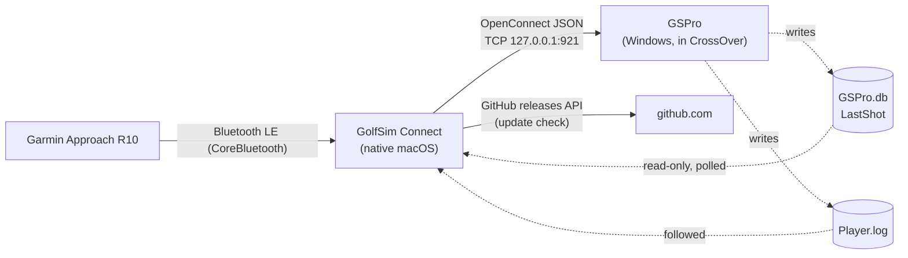
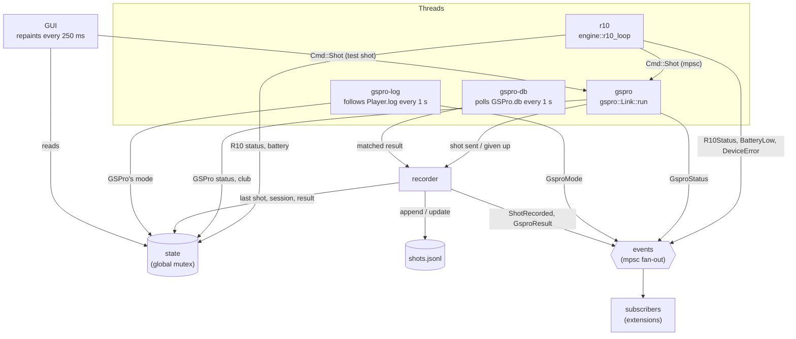
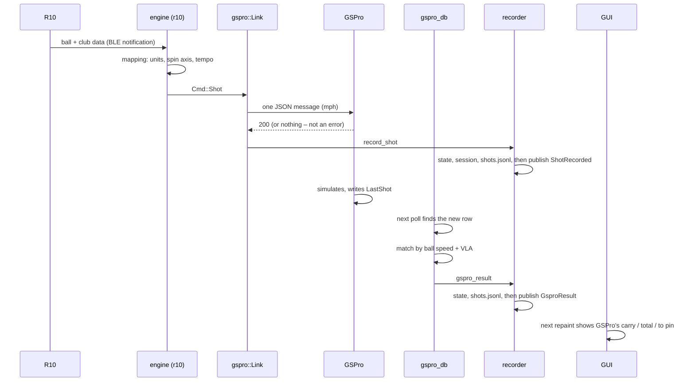

# Architecture

How GolfSim Connect is built: what runs where, how a shot travels from the launch monitor to
GSPro, where data is kept, and where the code is easy or hard to change. Decisions with their
reasons are recorded as [architecture decision records](adr/README.md).

For building, testing and the workflow, see [CLAUDE.md](../CLAUDE.md) and the [README](../README.md).

## Context

GSPro runs on an Apple Silicon Mac under CrossOver. CrossOver doesn't pass Bluetooth through to
Windows programs, so GSPro can't talk to a Garmin Approach R10 itself. GolfSim Connect is a
native macOS app that does the Bluetooth LE part and sends each shot to GSPro's OpenConnect API
over TCP.

What GSPro does **not** send back over OpenConnect (its carry, total, apex, offline, distance to
the pin) is read from its own SQLite database in the CrossOver bottle
([ADR-002](adr/adr-002-gspro-results-from-its-database.md)). Where GSPro is – its menus, the range or
a course – is followed in the log it writes next to it ([ADR-011](adr/adr-011-gspro-mode-from-its-log.md)).

## Building blocks

One crate with a library and two binaries. The GUI is part of the library, behind the cargo
feature `gui` (on by default), so another crate can build its own app binary from it
([ADR-008](adr/adr-008-ui-in-the-library.md)); the CLI builds without it.

| Part | Path | Role |
|---|---|---|
| Library | `src/lib.rs` | Everything both binaries share: device, GSPro link, data, settings, texts |
| App | `src/ui/` (module `ui`, feature `gui`) | The egui/eframe GUI: pages, overlays, shots explorer, macOS window handling |
| App binary | `src/bin/openlaunch-connect/main.rs` | `openlaunch-connect`: calls `ui::run()` (another crate calls `ui::run_with` with its pages) |
| CLI | `src/main.rs` | `openlaunch`: the bridge without a GUI (test shots, debug output); `--no-default-features` leaves egui out |
| R10 protocol | `vendor/tenover/` | Vendored [10over](https://github.com/divotmaker/10over) with local patches ([ADR-003](adr/adr-003-vendor-tenover-with-local-patches.md)) |
| Packaging | `make-app.sh`, `packaging/` | App bundle, icon, ad-hoc signing, licenses |

### Library modules

| Module | Responsibility | Depth |
|---|---|---|
| `engine` | Starts the bridge threads; the R10 loop (scan, connect, reconnect, events → status); demo and test shots | Mixes the R10 adapter with generic start-up and demo code |
| `mapping` | R10 data → OpenConnect units (m/s → mph, spin axis inverted, back/side spin), swing tempo | Deep, pure |
| `gspro` | OpenConnect client `Link`: one JSON per read, pacing, replies 200/201/5xx, heartbeats, reconnect, holding a shot while GSPro is away | Deep; hands each shot to the recorder |
| `gspro_db` | GSPro's own results from `GSPro.db` (`LastShot`), matched to our shots by ball speed and launch angle | Deep; hands each result to the recorder |
| `gspro_log` | Where GSPro is (menu, range, course), from markers in its `Player.log`; `state.gspro_mode` and `Event::GsproMode` | Small; a follower that starts over when GSPro starts a new log |
| `recorder` | Records a shot and GSPro's result of a shot: state, session, `shots.jsonl`, notification, then the event | Small |
| `events` | Bridge events: `subscribe()` → mpsc receiver, `publish()` to every subscriber ([ADR-007](adr/adr-007-bridge-events.md)) | Small, one enum and two functions |
| `flight` | Estimated ball flight (drag/lift, 3D, roll-out) when GSPro's result is missing | Deep, pure |
| `misread` | Plausibility check: marks a shot with a reading no club gives (left out of stats, still sent to GSPro) | Small, pure |
| `shape` | Shot shape names (e.g. "Push-Draw") from start direction and spin axis | Deep, pure |
| `history` | `shots.jsonl` (append/update), per-club stats, CSV exports | File IO next to pure stats |
| `settings` | `settings.json`, data directory, migration from earlier names, overlay arrangements; tolerant of unknown values | One flat struct; a tile is its kind's id, size and settings as JSON |
| `state` | Process-wide status read by the GUI (R10/GSPro status, last shot, session, log) | Shallow: public fields |
| `i18n` | `tr()` lookup, languages as data (code, native name, table; English is the source), language switch and locale resolution; tables added by other crates per language (`register`) | One file with one `match` per language (`i18n/de.rs`), its `mod` line and one line in `SHIPPED`, plus registered tables ([ADR-013](adr/adr-013-languages-as-registered-tables.md)) |
| `ui` | The app (feature `gui`): see [App](#app) | Public: `run`, `run_with`, `Page`, `AppCtx`, `kit`, the tile kind interface in `explorer`, re-exported `egui`/`eframe`; the rest `pub(super)` |
| `notify` | macOS notifications, rate-limited per kind | Small |
| `update` | Update check against GitHub releases | Small |
| `launcher` | Find and open the GSPro launcher in CrossOver | Small |
| `log` | Timestamped log to stderr and into `state`; each line masked (crate-internal `log::mask`: home folder → `~`, email addresses → `<email>`, nothing else) in `emit` and again in `state::push_log`, so `log::*` and a line an extension pushes with `push_log` are masked (masking twice changes nothing); a line written straight into `State.log` is not | Shallow; never log a token or a player's name – the mask is a safety net, so look a log over before posting it |

### App

The module `ui` (`src/ui/`):

| File | What |
|---|---|
| `mod.rs` | `run()`/`run_with()`, `App`, the *Play*, *Settings* and *Log* pages, zoom, screenshot capture |
| `help.rs` | The *Help* page: the common fixes and how to ask for help |
| `page.rs` | The `Page` trait, `AppCtx` (what pages share), the list of pages |
| `kit.rs` | Public building blocks: palette, `cond`/`caps_text`, `card`, `button`, `secondary_button`, `toggle`, `segments`, `stepper`, `setting_row`, `Icon`, `confirm`, `setup_style` |
| `overlay.rs` | Overlay windows, `OverlayContent` and its drawing, the *Overlay* page, arrangements |
| `explorer.rs`, `explorer/*.rs` | The *Shots* page (shots explorer), the tile kind interface, and the kinds: `table.rs`, `details.rs`, `dispersion.rs`, `scatter.rs` (correlation), `flight3d.rs` |
| `mac.rs` | AppKit: overlay frames, window levels, ordering above GSPro, the main window's size |

- **Pages** implement the trait `Page` (`id`, `label`, `ui`) and keep their own state
  ([ADR-010](adr/adr-010-pages-own-their-state.md)). `App` holds the list of pages – *Play*,
  *Shots*, *Log*, *Overlay*, the pages given to `run_with`, *Help*, *Settings* – and the window, zoom,
  overlays and capture. A page reaches what pages share through `AppCtx`: the settings and
  `change_settings`, the command sender, and for the core pages the Settings page's copy, the
  explorer state and the overlay being moved.
- **Shots explorer** (`ui/explorer.rs`): pages of tiles on a grid, a shared filter and selection.
  What a tile shows is up to its kind, behind the public trait `explorer::TileKind` (id, name,
  options, header, body; [ADR-009](adr/adr-009-tile-kinds-as-modules.md)). The core's kinds are
  modules of `ui/explorer/` (table with shots or averages, details, dispersion, correlation, 3D
  flight); another crate adds kinds with `explorer::register_tile_kind`. A kind draws from a
  `TileCtx` (shots, flights, units, selection) and keeps session state there (`state`, `shared`).
  In the settings a tile is its kind's id, its size and the kind's settings next to them; a tile
  of a kind the build doesn't have is kept and says what it needs.
- **Overlays** (`ui/overlay.rs`): the status overlay and tile overlays are extra egui viewports that stay with GSPro:
  above it while it is in front, ordered right above its window otherwise, on its screen, hidden without it. On macOS their
  frames, window levels and stacking above GSPro are set through AppKit (`ui/mac.rs`), because
  egui reports a second window's size in zoomed points and doesn't apply layer transforms there
  ([ADR-005](adr/adr-005-overlay-windows-placed-through-appkit.md)).
  `OverlayContent` builds what both the overlay window and the preview on the *Overlay* page draw.
- **Zoom**: the layout base size is 1000×470. With interface size *Auto* larger windows zoom the
  whole UI; the overlay windows run with their own zoom.
- **Look**: controls are drawn with the painter (`button`, `card`, `toggle`, `confirm`, …) in GSPro's
  in-game style, in the public module `ui::kit`, so pages from another crate look the same.
  Text in DIN Condensed is centred with `caps_text`.

## Runtime

Three long-running threads besides the GUI, plus short-lived ones (the update check, opening the
GSPro launcher).

### A shot, end to end

The OpenConnect rules learned the hard way (one message per read, unique shot numbers, identical
shots ignored, focus under CrossOver) are listed in [CLAUDE.md](../CLAUDE.md).

### Shared state

The threads write into `state`, the snapshot the GUI draws each frame. What happens is also
published as an `events::Event` ([ADR-007](adr/adr-007-bridge-events.md)): `ShotRecorded`,
`GsproResult`, `R10Status` and `GsproStatus` (on a change), `BatteryLow`, `DeviceError`. Every
receiver from `events::subscribe()` gets every event, in the same order; an event is published
after its state is written, and publishing never blocks. Nothing in the app subscribes yet: the
GUI still compares the key of the last shot of the list a tile shows to animate a new shot, since
that list isn't always the session (all time, the preview's sample shot).

| Global | Written by | Read by |
|---|---|---|
| `state::STATE` (via `state::with`) | engine, gspro, recorder, gspro_db (reads), update, log | GUI |
| `events` subscribers | `events::subscribe` | `events::publish` (engine, `state::set_r10`/`set_gspro`, recorder) |
| `history::PERSIST` | `engine::start` (off in demo mode) | history writes |
| `settings::SAVE` | tests (off) | `Settings::save` |
| `gspro::DEBUG` | GUI, CLI | `Link` |
| `i18n` active language (an index into `languages()`) | GUI, tests (per thread in unit tests) | `tr` |
| `i18n` registered tables (by language code) | `i18n::register` (other crates) | `tr`, `tr_detail`, `untranslated`, `languages` |
| `notify::ENABLED` | GUI | `notify::alert` |

## Data

| What | Where | Written by | Notes |
|---|---|---|---|
| Instance lock | `…/GolfSim Connect/instance.lock` | app and CLI at start (`Settings::claim_data_dir`) | Empty; an exclusive lock held for the whole run, released by the OS (ADR-012) |
| Settings | `~/Library/Application Support/GolfSim Connect/settings.json` | GUI, "apply and save at once" | Write-then-rename; an earlier data folder moves in at start (see below) |
| Shot history | `…/GolfSim Connect/shots.jsonl` | `recorder` (append, GSPro's result), explorer (excluded) | One JSON line per shot; test and demo shots are not kept |
| GSPro's results | `…/CrossOver/Bottles/<bottle>/drive_c/users/<user>/AppData/LocalLow/GSPro/GSPro/GSPro.db` | GSPro | Opened read-only |
| GSPro's log | `Player.log` next to `GSPro.db` | GSPro (Unity) | Read-only; only the mode markers are used – it also holds the player's name |
| App log | stderr + the last 400 lines in `state` | `log` | English; home folder and email addresses masked; copied by *COPY LOG*; the app writes no log file and sends it nowhere |

### Single instance and migration

The app (`ui::run_with`) and the CLI claim the data folder before anything else touches it
(`Settings::claim_data_dir`, `instance.rs`, ADR-012): lock `instance.lock`, then migrate, then read
the settings. A second instance doesn't get the lock and stops without writing – the app with a
short message, the CLI with "already running" and exit code 1; `--test-shot` takes no lock. Where
no lock is possible (no `HOME`, the folder can't be made) the app logs it and runs without one.
Before that, the lock of each earlier data folder that has an `instance.lock` is tried: held, a
build of the earlier name is still running, so nothing moves and the app says that this one is
still running; taken, it is held until the move is done.

Migration: the first earlier data folder that exists (`OpenLaunch Connect`, then `OpenR10 Connect`) moves into the data folder
while that has no `shots.jsonl`, entry by entry by name with `shots.jsonl` last. On a name clash the
earlier entry wins and the other is kept as `<name>.before-move`; lock files never move. A marker
`migration.pending` in the data folder, written before the first entry moves and removed once every
entry is in, makes the move go on at every start until it is complete – after a crash or an error,
and even when the data folder has a `shots.jsonl` by then. Going on, an entry of the data folder
changed after the move began (later than the marker) stays (the earlier one is kept as
`<name>.before-move`), and two histories are joined once, the earlier lines first. Without the marker, a data folder with a
`shots.jsonl` is never changed.

## Platform

- **Bluetooth**: btleplug on CoreBluetooth. The permission belongs to the app bundle
  (`NSBluetoothAlwaysUsageDescription`). The R10 doesn't appear in the macOS Bluetooth settings.
- **Windows of the app**: AppKit through `objc2` for overlay frames, window levels, ordering
  above GSPro's window and full-screen spaces (`ui/mac.rs`).
- **GSPro under CrossOver**: GSPro's processes are Wine processes named `GSPro.exe` /
  `GSPconnect.exe`; its files live in the bottle's `drive_c`.

## Quality

- `cargo test --all-targets` runs in CI on a macOS runner, then `make-app.sh` builds the bundle.
- Unit tests cover the pure modules (`mapping`, `flight`, `shape`, stats and CSV in `history`,
  matching in `gspro_db`, settings serialization). GUI tests use egui_kittest; they are lib tests
  and run beside the others (they hold `test_util::state_lock()` where they use the shared state).
- README screenshots are rendered offscreen (`readme_screenshots`), not compared to a reference.
- Bluetooth, GSPro and overlay behaviour are tested by hand with a real R10 and GSPro.

## Where change is hard today

Found in an architecture review; the planned work makes these places extensible so that features
can be added without editing the core in many places.

- **Settings**: still one flat struct, but it reads what a newer or extended build wrote: an
  unknown value drops only its entry, unknown top-level keys are written back unchanged, and an
  unreadable file is kept as `settings.json.bad` ([ADR-006](adr/adr-006-settings-tolerate-unknown-values.md)).
  The GUI changes settings through one method, `AppCtx::change_settings`. Left: unknown keys inside
  nested objects and dropped entries are still lost on the next save.
- **Events**: shots, GSPro's results and status changes are published as events
  ([ADR-007](adr/adr-007-bridge-events.md)), and recording moved from `gspro` into `recorder`.
  Left: the GUI doesn't subscribe yet (it diffs the shots a tile shows), and events published
  before a subscriber subscribed aren't replayed.
- **Tile kinds**: each kind is a module behind the trait `explorer::TileKind`; a new one is a
  module and an entry in `CORE_KINDS` (or `register_tile_kind` from another crate) plus its German
  texts; tiles of unknown kinds survive a save ([ADR-009](adr/adr-009-tile-kinds-as-modules.md)).
  Left: kinds share one namespace of keys in a tile.
- **Pages**: each page is a type implementing `Page` with its own state; the navigation,
  `OPENLAUNCH_PAGE` and the README screenshots go through one list, and another crate adds pages
  with `ui::run_with` ([ADR-010](adr/adr-010-pages-own-their-state.md)). Left: an extension's
  page sees only the settings and the command sender; no premium marker yet.
- **UI in the library**: the UI is the module `ui` behind the feature `gui`, its building blocks
  are public (`ui::kit`), and other crates add translations with `i18n::register`
  ([ADR-008](adr/adr-008-ui-in-the-library.md), per language since
  [ADR-013](adr/adr-013-languages-as-registered-tables.md)), tile kinds with `explorer::register_tile_kind`
  and pages with `ui::run_with`.
- **Launch monitors**: R10 code and generic code are mixed in `engine` and `mapping`; names like
  `R10Status` are used for generic status. Left until a second device is added (issue #1).

Planned order: settings, events, moving the UI into the library together with its building blocks
and translations, then pages and tile kinds (all done).
